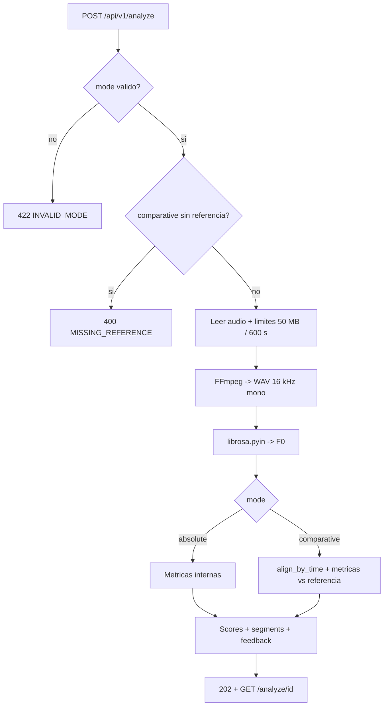

# Arquitectura — singing-service

## 1. Rol en SyncDance

Microservicio **stateless** de análisis de canto. Recibe un audio (intento del alumno y,
opcionalmente, referencia), devuelve métricas y feedback. No gestiona auth, no persiste
y no conoce usuarios: la fuente de verdad es el Core (PostgreSQL).

- Puerto: `5000` (red interna Docker; sin publicar en producción).
- API: `POST /api/v1/analyze` (202) + `GET /api/v1/analyze/{id}` + `GET /health`.
- Contrato: [`celery-contract.md`](celery-contract.md).

## 2. Vista de componentes internos

```
singing-service/
├── app/
│   ├── main.py                  # FastAPI app, /health (checks), /docs
│   ├── api/routes/analyze.py    # POST/GET /analyze, semáforo, idempotencia
│   ├── core/
│   │   ├── config.py            # settings por env (límites, TTL, concurrencia)
│   │   ├── log.py               # eventos JSON una-línea (RNF-03)
│   │   └── store.py             # almacén TTL en memoria + índice attempt_id
│   ├── schemas/analyze.py       # contrato Pydantic (request/response)
│   ├── services/
│   │   ├── preprocess.py        # FFmpeg → WAV 16 kHz mono, validaciones
│   │   ├── pitch.py             # librosa.pyin → F0 + silence_pct
│   │   ├── compare.py           # align_by_time (comparación simple) + notas JSON
│   │   ├── metrics.py           # métricas absolute/comparative
│   │   ├── scoring.py           # scores 0–100
│   │   ├── feedback.py          # códigos y mensajes (HU-46)
│   │   ├── rhythm_eval.py       # stub (diferido a Sprint 1)
│   │   └── align.py             # FastDTW (reservado para Sprint 1; no en la ruta)
│   └── mock/data.py             # fixture con valores de Figma (no expuesto por API)
├── tests/                       # 70 tests de servicio
├── integration/                 # simulador Celery, matriz de errores, fixtures, verify
└── docs/                        # contrato, arquitectura, backlog, troubleshooting
```

> Nota: el diseño inicial hablaba de `pitch_detector.py`, `feedback_gen.py` y
> `rhythm_eval.py` dentro de `core/`. La implementación real los ubica en
> `app/services/` como `pitch.py`, `feedback.py` y `rhythm_eval.py`; `app/core/` quedó
> para configuración, logging y store.

## 3. Contrato de API

Ver [`celery-contract.md`](celery-contract.md) para el detalle completo.

- **Request** (`multipart/form-data`): `audio` (archivo, obligatorio), `attempt_id`,
  `routine_id`, `mode=absolute|comparative`; en comparative, `reference_audio`
  (archivo) o `reference_notes` (JSON).
- **Response**: `analysis_id`, `attempt_id`, `routine_id`, `status`, `mode`,
  `algorithm_version`, `duration_sec`, `pitch`, `segments`, `scores`, `metrics`,
  `feedback`, `timings`.
- **Futuro**: `pitch_contour` (flag `include_contour`, Sprint 1) y `rhythm_accuracy`
  real (Sprint 1).

## 4. Flujo interno de `/analyze`



Pasos:

1. Validar `mode` (422 `INVALID_MODE` si es inválido).
2. Validar referencia (400 `MISSING_REFERENCE` en comparative sin referencia).
3. Idempotencia por `attempt_id` (devuelve el mismo `analysis_id` si ya existe).
4. Adquirir semáforo (2 análisis simultáneos; 429 `SERVICE_BUSY` si se llena).
5. Validar extensión y tamaño (400 / 413).
6. Decodificar con FFmpeg a WAV 16 kHz mono (400 si falla; 413 si dura > 600 s).
7. `librosa.pyin` → F0 (fmin 65, fmax 1600) y `silence_pct`.
8. Si comparative: `compare.align_by_time` (nearest-neighbor temporal) + métricas.
9. Scores 0–100, segmentos y feedback.
10. Guardar en el store TTL y devolver 202; el Core hace `GET` del resultado.

## 5. Decisiones técnicas

- **`async def` + `run_in_threadpool`:** el endpoint es `async def` (recibe uploads y
  orquesta), pero FFmpeg, pyin y scoring corren en `run_in_threadpool` para no bloquear
  el event loop. No se usa `def` sync para el endpoint.
- **Uvicorn con 1 worker** (CMD actual). La concurrencia interna se limita con
  `threading.Semaphore(MAX_CONCURRENT_ANALYSES=2)`; el escalado es horizontal (réplicas).
- **Sin auth interna:** confianza en la red Docker; el servicio no se publica fuera.
- **Sin persistencia:** store en memoria con TTL de 1 h; la fuente de verdad es el Core.
- **FFmpeg por subprocess** (no pydub). `ffmpeg-python==0.2.0` queda instalado para
  probing/estandarización, pero la ruta usa `subprocess` directo.
- **`rhythm_eval` diferido a Sprint 1:** stub explícito; `rhythm_accuracy=null`.
- **Comparación simple, no DTW:** `align_by_time` remuestrea la referencia sobre los
  tiempos del alumno. `align.py` (FastDTW) queda reservado para Sprint 1.

## 6. Dependencias externas

- **FFmpeg** (sistema/Docker): decodificación y normalización de audio.
- **librosa**, **soundfile**, **numpy**, **scipy**: pitch y análisis.
- **numba/llvmlite**: JIT de pyin (causa el arranque frío).
- **FastAPI**, **Uvicorn**, **Pydantic**, **python-multipart**.

## 7. Riesgos conocidos

- **JIT frío de numba/llvmlite:** el primer análisis puede tardar ~25 s; mitigación en
  HU-S1-06 (warm-up).
- **CPU-bound:** pyin/FFmpeg consumen CPU; escalar horizontalmente (réplicas/HPA) y
  mantener el semáforo para no saturar.
- **Imagen Docker ~1.6 GB** (aceptable; revisar si crece con CREPE/GPU).
- **Sin timeout interno de pyin** (sólo FFmpeg 120 s); mitigación en HU-S1-05.

## 8. Links

- [`celery-contract.md`](celery-contract.md) — contrato con Core.
- [`SPRINT1_BACKLOG.md`](SPRINT1_BACKLOG.md) — siguiente sprint.
- [`TROUBLESHOOTING.md`](TROUBLESHOOTING.md) — problemas comunes.
- [`../integration/README.md`](../integration/README.md) — kit de integración.
